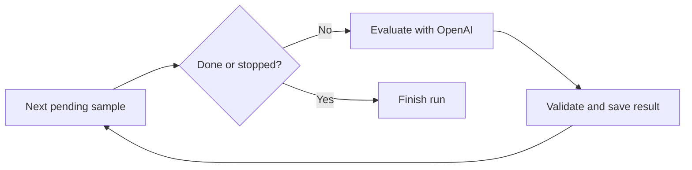
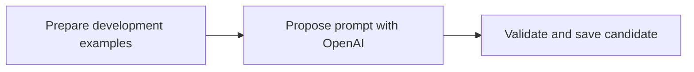

# AI-origin experiment lab

A LangGraph dashboard for collecting human-labeled text, evaluating AI-origin
prompts, reviewing model-proposed improvements, and backtesting candidates.
This is prompt optimization with human feedback, not model-weight training.
LangSmith is optional and disabled by default.

## Start independently

Requires Python 3.11 or newer. From this repository's root:

```bash
python3 -m venv .venv
.venv/bin/python -m pip install -r requirements.txt
# Export CHAT_GPT_KEY in this shell before starting.
.venv/bin/python dev_server.py
```

Open **http://localhost:8383/ai-origin/**. The standalone server binds to
`127.0.0.1`; `HOST` and `PORT` override its address and port. Stop with **Ctrl+C**.
For another computer on your network, set `HOST=0.0.0.0` and `AI_ORIGIN_TOKEN`.
There is no Node.js or Kvasir dependency. The root launcher runs
`src/ai-origin/dev.py`, serving only `src/html/ai-origin` and its API.

## Use the existing Kvasir dev server

Keep the checkouts as siblings:

```text
git/
  kvasir_proto/
  ai-origin/
```

Set up `.venv` above, then run the normal Kvasir command:

```bash
cd ../kvasir_proto/src/html
npm run serve
```

The updated Kvasir dev server resolves `../ai-origin` relative to its repository
root and automatically uses `ai-origin/.venv` when present. Existing site routes
and **http://localhost:8383/ai-origin/** work together. Its `npm run dev` command
works too. Restart the server after switching checkouts or Python code.
Do not run both servers on port 8383 simultaneously; use another `PORT` if needed.

Environment:

| Variable | Purpose |
| --- | --- |
| `CHAT_GPT_KEY` | OpenAI API key; takes precedence over `OPENAI_API_KEY`. Never sent to the browser or saved in history. |
| `HOST` / `PORT` | Standalone bind address (default `127.0.0.1`) and port (default `8383`). Kvasir retains its own bind behavior. |
| `AI_ORIGIN_DATA_DIR` | Defaults to `~/ai-origin` (`/home/anton/ai-origin` for Anton). Created on first API access. |
| `AI_ORIGIN_TOKEN` | Optional access token. If set, enter it under **Remote access**, including on localhost. Without it, the API accepts loopback clients and localhost hosts only. |
| `LANGSMITH_TRACING` | Defaults to `false`, as requested. Set `true` explicitly to enable tracing later. |
| `LANGSMITH_API_KEY` | Required only if enabling LangSmith later. |
| `LANGSMITH_PROJECT` | Optional tracing project, default `kvasir-ai-origin`. |

Standard `AWS_ACCESS_KEY_ID`, `AWS_SECRET_ACCESS_KEY`, `AWS_SESSION_TOKEN`, and
AWS region/profile variables are inherited unchanged. This file-based version
does not call AWS or require AWS credentials. There are no database changes.
For remote access use an HTTPS reverse proxy or SSH tunnel; this dev server itself
speaks HTTP. Its normal static-site exposure is unchanged.

## Use

1. **Samples:** add text, language, manual probability and acceptable interval.
   All three numbers are percentages, not fractions of generated words. Record
   known human / known AI / mixed provenance separately from your estimate.
   Assignment context is optional. Materials mode is **use**, **unavailable**, or
   **irrelevant**; `use` requires supplied materials. You can edit samples later.
2. **Evaluate:** choose the current repository prompt or a saved candidate, a
   model from the account's live `/v1/models` response, effort, and sample strategy.
   The current prompt is read from `src/system_bucket/exam/grade/ai_origin.txt`
   each time a run starts. No cached or deployed S3 prompt is substituted.
3. **Run history:** inspect all selected samples, the manual/model percentages,
   model explanations and errors; export the entire table to CSV. Text links open
   the version saved in that run. Jobs run in the background; the page polls while
   they are active. Stop prevents the next call but saves any in-flight response.
4. **Improve:** choose a source run, another model and optional guidance. The
   graph sends completed **development** examples, their results and metrics to
   the improver. It saves a complete replacement prompt plus rationale.
5. **Prompts:** inspect the diff against the exact parent prompt, edit/save a new
   candidate version, or mark a candidate approved/rejected with a review note.
   **Approval does not overwrite the repository or deploy anything.**
6. **Backtest:** select a candidate and choose an earlier run under “Backtest the
   exact samples from”. Its immutable sample snapshots override the split and
   selection settings. Results include a paired comparison with that run.

Models are discovered, not hardcoded. The o-series and GPT-4o families (including
dated and fine-tuned variants) are excluded from discovery and blocked for new
evaluation/improvement calls. Historical runs remain readable. The model-list API does not expose endpoint
or reasoning capability metadata: the UI filters obvious non-text models and
offers family-based effort choices. “Auto” omits the effort parameter. Unsupported
combinations produce a saved API error, never a silent model/effort substitution.
New model families may require updating `provider.model_efforts` after checking
their documentation. Input truncation and automatic paid retries are disabled.

Run history includes a **Difference distribution** histogram above the results
table: model minus manual estimate, in 10-percentage-point bins. Only successful
predictions count. Below **Evaluation run**, a chronological chart tracks **MAE,
RMSE, and signed bias**, all in percentage points. Filter by dataset, hover/focus
points for details, or select a point to open that run. Completed runs with errors
use successful rows; other unfinished/failed runs are excluded. Different samples
or settings can change metrics, so use paired backtests for controlled comparisons.

## Selection and metrics

Each sample belongs to one dataset, chosen when adding or editing it:

- **Development:** examples that may inform prompt improvements.
- **Holdout:** reserved evaluation examples.
- **Test:** samples deliberately added for a particular test, kept separate from
  Holdout and excluded from prompt improvements.

Use **Samples → Add text → Dataset → Test** to add a test sample, then choose
**Evaluate → Dataset → Test** to evaluate it. **All datasets** includes all three.
Existing sample assignments and historical run snapshots are unchanged.

- **All:** every sample in the chosen development/holdout/test split.
- **Balanced random %:** select `ceil(N × percent / 100)` unique samples. Strata
  are language × manual-probability band: `[0, 33⅓)`, `[33⅓, 66⅔)`, `[66⅔, 100]`.
  Seeded round-robin sampling balances available strata; depleted strata yield
  their remaining quota to others. This is balanced sampling, not a
  population-proportional accuracy estimate.
- **Manual:** checked samples within the chosen split.

Manual-agreement metrics are MAE, RMSE, signed bias (positive = estimates too
high), interval hit rate and mean distance outside the acceptable interval.
Errors use **percentage points**. Accuracy, precision, recall, false-positive
rate and Brier score use **only confirmed human/AI origins**, at the run's saved
threshold; unknown/mixed examples do not enter those metrics. Undefined rates
display a dash. Failed/pending responses never become 0% predictions. Results
are also grouped by language, materials mode and dataset split.

Holdout and Test examples and their aggregate metrics are excluded from improvement input.
Choose related student versions/assignment variations for the same split manually.
Repeatedly choosing prompts based on one holdout set can still overfit it: refresh
the holdout as the library grows. Agreement scores do not calibrate probabilities.

## Repository contents

- `src/ai-origin/`: commented Python backend, graphs, and tests.
- `src/html/ai-origin/`: self-contained dashboard HTML, JavaScript, and CSS.
- `src/system_bucket/exam/grade/ai_origin.txt`: working prompt copied verbatim
  from Kvasir on 2026-10-12, retaining the original outer folder structure.
  It has no file includes; unrelated academic grading prompts were not copied.
- `output/imagegen/`: workflow illustrations and their generation instructions.
- `dev_server.py`, `requirements.txt`, `requirements-dev.txt`: standalone setup.

The lab now reads its own prompt copy. Future Kvasir production-prompt changes
are not synchronized automatically. Kvasir retains its original production
prompt and grading code. This lab collects pasted text, not exam API imports.

## Files on disk

```text
/home/anton/ai-origin/
  .server.lock                  # prevents multiple writers to this directory
  samples/sample_<id>.json      # text, labels, language, context, revision
  runs/run_<id>.json            # settings, exact prompt and sample snapshots,
                               # per-sample requests/responses, errors, metrics
  runs/run_<id>.txt             # convenient copy of the prompt used
  improvements/improvement_<id>.json  # source, settings, request, response, candidate ID
  candidates/candidate_<id>.json      # prompt, exact parent, rationale, review log
  candidates/candidate_<id>.txt       # convenient prompt text
```

JSON is authoritative; generated TXT files are convenient exports. Each write
uses an atomic temporary-file rename. Sample edits increment a revision; stale
browser edits are rejected. Previous runs keep their own immutable snapshots.
After restart, queued/running jobs become `interrupted`, preserving completed
results. No paid request is automatically replayed. A new/backtest run is explicit.

## Python reading guide

Start with `schemas.py`, then `graphs.py`:

- `schemas.py`: Pydantic contracts and cross-field validation.
- `storage.py`: file layout, atomic writes, locks and interrupted-job recovery.
- `metrics.py`: deterministic selection and arithmetic quality measures.
- `provider.py`: authentication, model discovery, exact Responses API payloads.
- `graphs.py`: actual LangGraph nodes and edges for evaluation and improvement.
- `service.py`: operations shared by graph nodes and HTTP, background worker,
  snapshots, candidate reviews, CSV export.
- `http_api.py`: small HTTP adapter, local/token access and input validation.
- `dev.py`: standalone HTTP server; Kvasir imports the same HTTP adapter separately.

Evaluation graph:



Improvement graph:



LangSmith integration is ready but **disabled by default**. When explicitly
enabled, graph nodes are traced automatically and the provider call is a child
LLM trace. Traces include prompts/sample content and responses, not API keys.
Files remain the local history even with tracing disabled. This is not a hidden
LangGraph checkpoint database: files hold each completed sample boundary, and
restarts deliberately do not resume ambiguous paid requests.

## Verification

```bash
.venv/bin/python -m pip install -r requirements-dev.txt
.venv/bin/python -m pytest -q src/ai-origin/test_lab.py src/ai-origin/test_http.py

# Optional: test the sibling Kvasir mount using the same HTTP/browser suite.
KVASIR_DEV_SERVER=../kvasir_proto/src/html/dev_server.py \
  .venv/bin/python -m pytest -q src/ai-origin/test_http.py
```

Tests use real compiled LangGraph workflows with a fake provider and temporary
files. They cover sampling, metrics, label isolation, holdout exclusion, frozen
backtests, cancellation, failures, restart recovery, HTTP guards and the browser
workflow. Browser tests use installed Chrome/Chromium and Python Playwright;
they skip when unavailable. No test needs a real API key or writes real samples.

References used for the integration: [OpenAI model listing](https://developers.openai.com/api/reference/resources/models/methods/list),
[structured outputs](https://developers.openai.com/api/docs/guides/structured-outputs?api-mode=responses),
[reasoning effort](https://developers.openai.com/api/docs/guides/reasoning),
[LangGraph Graph API](https://docs.langchain.com/oss/python/langgraph/graph-api),
[LangSmith instrumentation](https://docs.langchain.com/langsmith/annotate-code).
